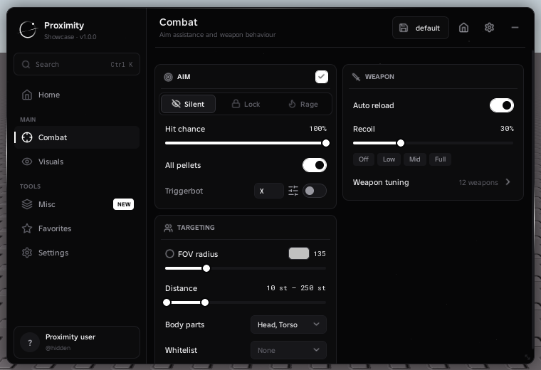
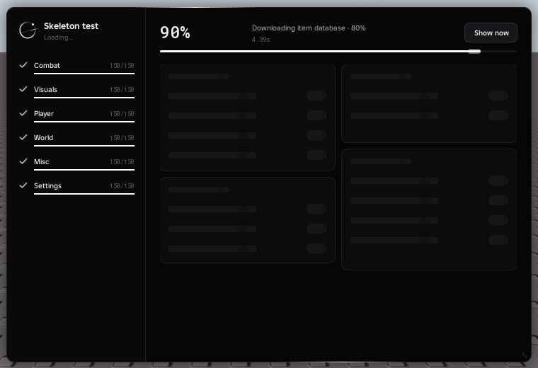

<div align="center">

<b>English</b> · <a href="README.ru.md">Русский</a>



[](CHANGELOG.md)
[](LICENSE)
[](https://proximitydevproject.github.io/ProximityGUI/executors.html)
[](https://proximitydevproject.github.io/ProximityGUI/)

</div>

```lua
local Proximity = loadstring(game:HttpGet("https://proximitydevproject.github.io/ProximityGUI/Proximity.lua"))()
```

<sub>Fixed version: <code>https://proximitydevproject.github.io/ProximityGUI/v/1.3.0.lua</code> · straight from the repo: <code>https://raw.githubusercontent.com/ProximityDevProject/ProximityGUI/main/dist/Proximity.luau</code></sub>

**Website with docs, a menu builder and live executor status: https://proximitydevproject.github.io/ProximityGUI/** (English and Russian)

---

## Quick start

```lua
local Proximity = loadstring(game:HttpGet("https://proximitydevproject.github.io/ProximityGUI/Proximity.lua"))()

local Window = Proximity:Window({ Title = "My Hub", Animation = "Swing", Loading = { Style = "Planet" } })

local Combat = Window:Tab({ Name = "Combat", Icon = "crosshair" })
local Aim = Combat:Section({ Name = "Aim", Toggle = true, Flag = "aim" })

Aim:Toggle({ Name = "Silent aim", Flag = "aim.silent", Callback = function(on) end })
    :Keybind({ Default = "Ctrl+X", Mode = "Hold" })
Aim:Slider({ Name = "FOV", Min = 10, Max = 500, Default = 135, Danger = 400 })
Aim:Gallery({ Name = "Knife", Items = { { Name = "Default", Image = 10734898934 }, { Name = "Fade", Image = 10734919691, Rarity = "Rare" } } })

Proximity:Bind("aim.silent", function(on) end)   -- runs now, on every change and with false on unload
Window:SettingsTab()                             -- themes, sounds, screen, server, output, configs
```

No `Init()` to call: the window notices when your script has finished and reveals itself.

## Features

<table>
<tr>
<td width="33%" valign="top"><br/><b>7 loading screens</b><br/><sub>Planet, Orbit, Eclipse, Constellation, Terminal, Skeleton or none. Each one shows real progress and the time left.</sub></td>
<td width="33%" valign="top"><br/><b>12 menu animations on springs</b><br/><sub>Planet, Rise, Zoom, Drop, Slide, Swing, Wipe, Unfold, Scan, Glitch, Fade. Press the key mid-way and they turn around smoothly.</sub></td>
<td width="33%" valign="top"><br/><b>A key for anything</b><br/><sub>Right-click any element: add a key, type an exact value, open its options. Works even where the script gave no keybind.</sub></td>
</tr>
<tr>
<td valign="top"><br/><b>Ctrl + K that forgives typos</b><br/><sub>Finds features, tabs and actions, understands the wrong keyboard layout ("ghbdtn" finds "привет") and small mistakes.</sub></td>
<td valign="top"><br/><b>Configs that travel</b><br/><sub>Protected files, backups, undo delete, share codes, JSON and Lua export, compare, a profile per game, auto save.</sub></td>
<td valign="top"><br/><b>Unload takes everything back</b><br/><sub>Connections, loops, changed properties, hooks, created instances and binds all go through the library and are undone.</sub></td>
</tr>
<tr>
<td valign="top"><br/><b>10 themes and a 3D logo</b><br/><sub>Eclipse, OLED, Graphite, Moon, Ash, Steel, Paper, Midnight, Graphite Blue, Mono Glass. High contrast, corner style, accent from your character.</sub></td>
<td valign="top"><br/><b>Gallery cards</b><br/><sub>Picture cards for skins or teleports: the current choice large on top, every option below, rarity stripes, search.</sub></td>
<td valign="top"><br/><b>45+ elements</b><br/><sub>Toggle (9 styles), sliders with danger zones, Segmented, Stepper, dropdowns, tables, player list, ESP preview, crosshair editor, code editor.</sub></td>
</tr>
<tr>
<td valign="top"><br/><b>Widgets</b><br/><sub>Watermark, keybind list, session data, event feed, chat log, friends here, who is looking at you, inventory viewer, music player.</sub></td>
<td valign="top"><br/><b>Sounds and media</b><br/><sub>Click sounds, notification sounds, 16 hit sounds, 12 hit markers, cursors - downloaded once and cached.</sub></td>
<td valign="top"><br/><b>Phone friendly</b><br/><sub>A tab bar at the bottom, touch density, safe areas, swipe-away notifications, a floating planet button.</sub></td>
</tr>
</table>

## Compared with other libraries

| | Proximity | Rayfield | Orion | Linoria |
|---|:---:|:---:|:---:|:---:|
| Loading screen with real progress | yes | intro only | intro only | - |
| Search across the whole menu (Ctrl + K) | yes | - | - | - |
| Undo and redo | yes | - | - | - |
| A key on any element from its right-click menu | yes | - | - | - |
| Choice of open animations | 12 | - | - | - |
| Configs | yes, with share codes and per-game profiles | yes | yes | yes (add-on) |
| Themes | 10 + editor + import from these three | yes | partly | yes (add-on) |
| Unload undoes what the script changed | yes | - | - | - |
| Bottom tab bar on phones | yes | - | - | - |

<sub>Based on the public versions of those libraries. If something here is out of date, open an issue and we will fix it.</sub>

## Screenshots

<table>
<tr>
<td width="50%"><br/><sub><b>Sections</b> - toggle headers, tabs inside a section, linked keybinds and colours</sub></td>
<td width="50%"><br/><sub><b>Ctrl + K</b> - jump to any feature, tab or action</sub></td>
</tr>
<tr>
<td><br/><sub><b>Skeleton loading</b> - every tab builds with its own progress</sub></td>
<td><br/><sub><b>Data</b> - live graphs, progress and sortable tables</sub></td>
</tr>
</table>

## For script authors

```lua
-- everything your script does can be taken back on unload
Proximity:Connect(game:GetService("RunService").Heartbeat, function() end)
Proximity:SetProperty(workspace.CurrentCamera, "FieldOfView", 100)   -- restored on unload
Proximity:HookFunction(someFunction, function(...) end)              -- unhooked on unload
Proximity:Loop(function() end, 0.5)

Proximity:Batch(function() ... end)          -- many :Set calls, one redraw
Proximity:Use(myPlugin)                      -- plugins: elements, themes, anything
Proximity:Localize({ ru = { Aim = "Аим" } })  -- your script in other languages
Proximity:ImportTheme(rayfieldTheme, "Rayfield")
```

Full reference: **[docs/API.md](docs/API.md)** (English) · **[docs/API.ru.md](docs/API.ru.md)** (Russian) · showcase script: **[examples/Full.luau](examples/Full.luau)**

## FAQ

**Which executors work?** It is tested on Potassium. Anything with the usual file, clipboard and `getcustomasset` functions should work; without them Proximity still runs and keeps configs in memory. Live status: [executors](https://proximitydevproject.github.io/ProximityGUI/executors.html).

**Does it work on phones?** Yes: a tab bar at the bottom, bigger rows and a floating planet button to open the menu.

**How do players update?** The loadstring always points to the latest build. Use the `/v/<version>.lua` link to stay on one version.

**How do I remove it?** `Proximity:Unload()` or the hold-to-confirm button in Settings. Everything your script registered with the library is undone.

**Terms.** *Flag* - the key a value is saved under in configs. *Section* - a card of elements inside a tab. *Page* - one view of a tab (tabs can have sub pages). *Bind* - a key that triggers an element.

## Building from source

```bash
sh tests/build.sh
```

The source in `src/` is bundled with [darklua](https://github.com/seaofvoices/darklua) and checked with [Lune](https://lune-org.github.io/docs) and [selene](https://github.com/Kampfkarren/selene). See [CONTRIBUTING.md](CONTRIBUTING.md).

## Credits

Proximity is original code. Ideas were studied in CompKiller, Neverlose Reloaded and MugiHub Gen 2 (all MIT). Icons: the Proximity set (MIT) and [Lucide](https://lucide.dev) (ISC). Media is described in [THIRD_PARTY.md](THIRD_PARTY.md).

<div align="center"><sub>MIT © Proximity</sub></div>
