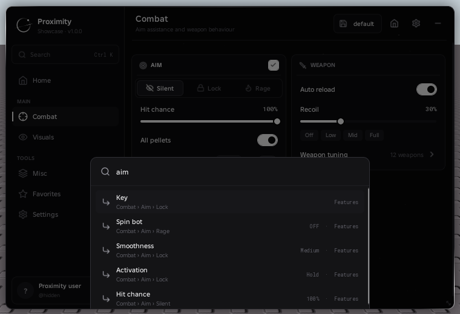
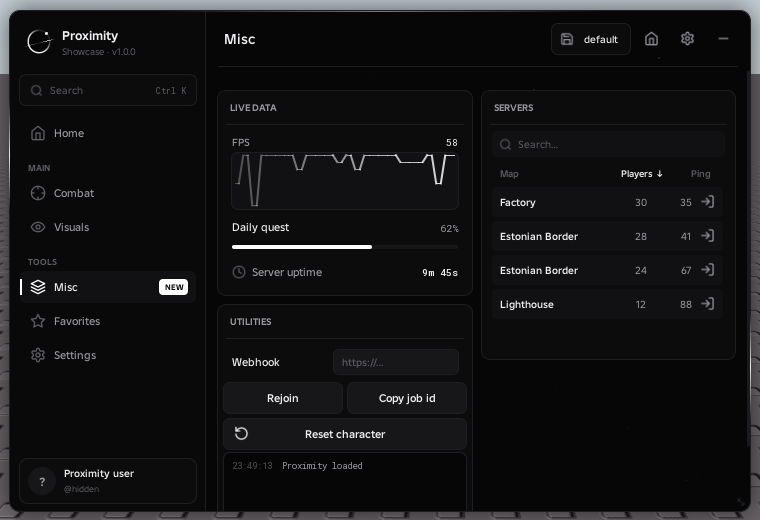

<div align="center">


# Proximity UI

**A black & white interface library for Roblox scripts.**
Calm surfaces, one white accent, and a planet that builds your menu while the script loads.

[](CHANGELOG.md)
[](LICENSE)
[](docs/API.md)
[](docs/API.md#icons)

</div>

```lua
local Proximity = loadstring(game:HttpGet("https://proximitydevproject.github.io/ProximityGUI/Proximity.lua"))()
```

**Docs, a code generator and live executor status: https://proximitydevproject.github.io/ProximityGUI/**
Fixed version: `https://proximitydevproject.github.io/ProximityGUI/v/1.2.3.lua` · straight from the repo: `https://raw.githubusercontent.com/ProximityDevProject/ProximityGUI/main/dist/Proximity.luau`

<table>
<tr>
<td width="50%"><br/><sub><b>Loading skeleton</b> - every tab builds with its own progress, your steps show as stages</sub></td>
<td width="50%"><br/><sub><b>Sections</b> - toggle headers, tabs inside a section, linked keybinds and colors</sub></td>
</tr>
<tr>
<td><br/><sub><b>Ctrl + K</b> - jump to any feature, tab or action</sub></td>
<td><br/><sub><b>Data</b> - live graphs, progress, sortable tables with row actions</sub></td>
</tr>
</table>

---

## New in 1.2

- **Planet intro**: the screen dims, a 3D planet assembles from points, turns into the Proximity artwork while the script loads with real progress and time left, then bursts and the window grows out of it
- **Key system** with one option, `KeySystem = true / false`
- **Window**: opens from and folds into a planet button next to the Roblox menu, icons-only navigation, mini mode, custom background, keyboard and gamepad control, remembered scroll
- **Look**: 9 toggle styles, about 50 fonts including Monocraft, density from compact to touch, chips in multi dropdowns, glow on active things, red stripe on risky sections
- **Elements and widgets**: player list, range filters in tables, key combos like Ctrl+Shift+X, player panel with a 3D model, FPS graph, stopwatch, your own HUD panels, a watermark with 16 items
- **Configs**: protected files, backups, undo delete, short share codes
- **Care**: notification center, what's new dialog, update check, `OnError`, clear option warnings, debug overlay, automatic FPS saving

## Why Proximity

| | |
|---|---|
| **Skeleton loading** | The window appears instantly as a skeleton that mirrors the real layout. Every tab fills its own progress bar while its elements are built (4 ms per frame, so the game never freezes). Your own loading work shows up as steps. When everything is ready, the skeleton fades into the finished interface. |
| **Eclipse design** | Near-black surfaces, hairline borders, a single white accent on sliders, switches and the active tab, plus a slow light rim that circles the window. Six monochrome presets, any custom accent, and a live theme editor. |
| **Everything is state** | Elements exist the moment you create them: `Get`, `Set`, flags and callbacks work before anything is drawn. Configs save JSON-safe values for every element type, including colors with alpha and keybinds with modes. |
| **Built for real hubs** | Toggle-headers that switch a whole section, tabs inside a section, option panels behind a gear, sub-pages with a back arrow, tables with sorting and search, live stat tiles with sparklines, a dashboard tab and a ready-made settings tab. |
| **Comfort** | `Ctrl+K` command palette, undo and redo, right-click menu on every row (reset, copy, paste, favorite), favorites tab, exact value entry on sliders, onboarding tour, anonymous mode for streamers, Russian and English out of the box. |
| **Safe** | No changes to `Lighting` or `Workspace`, no `loadstring` inside, safe fallbacks when file or clipboard APIs are missing, and running the script again cleanly replaces the old instance. |

## Quick start

```lua
local Proximity = loadstring(game:HttpGet("https://raw.githubusercontent.com/ProximityDevProject/ProximityGUI/main/dist/Proximity.luau"))()

local Window = Proximity:Window({ Title = "My Hub", Keybind = Enum.KeyCode.RightShift })

local Main = Window:Tab({ Name = "Main", Icon = "home" })
local Farm = Main:Section({ Name = "Farming" })

local auto = Farm:Toggle({ Name = "Auto farm", Flag = "farm.auto", Callback = function(on)
	print("auto farm", on)
end })
auto:Keybind({ Default = Enum.KeyCode.F, Mode = "Toggle" })
auto:Options(function(o)
	o:Slider({ Name = "Radius", Min = 10, Max = 200, Default = 60, Suffix = " st", Flag = "farm.radius" })
end)

Window:SettingsTab()   -- theme, accent, scale, language, widgets, configs, unload
```

There is no `Init()` to remember: the window notices when your script has finished declaring things and reveals itself.
For long setups, report progress yourself:

```lua
Window:Step("Loading item database", function(step)
	for i, chunk in chunks do
		load(chunk)
		step:Progress(i / #chunks)
	end
end)
```

## What's inside

<table>
<tr><td valign="top">

**Elements**
Toggle · Checkbox · Button · ButtonGroup
Slider · RangeSlider · TextSlider
Dropdown · MultiDropdown · PlayerDropdown
Input · Keybind · ColorPicker (alpha)
Label · Paragraph · Divider · Spacer
Navigate · Progress · Stat · StatGrid
Graph · Table · Card · Image · Console · Code

</td><td valign="top">

**Containers**
Window → Category → Tab → SubTab / SubPage
Section (Left · Right · Full)
Section toggle header · Tabs in a section
Option panels (`element:Options()`)
Dialog · Confirm · Prompt
Command palette · Tour

</td><td valign="top">

**Systems**
Configs: save, load, delete, rename, diff,
export / import strings, auto load, auto save
Themes and live theme editor · Locale
Notifications with actions · Watermark
Keybind list · Dock (corner snapping)
Undo / redo · Favorites · Anonymous mode

</td></tr>
</table>

The full reference with every option and method is in **[docs/API.md](docs/API.md)**. The complete showcase script is **[examples/Full.luau](examples/Full.luau)**.

## Keyboard

| Keys | Action |
|---|---|
| your menu key (default `RightShift`) | show / hide |
| `Ctrl + K` | search features, tabs and commands |
| `Ctrl + Z` / `Ctrl + Y` | undo / redo the last change |
| `Ctrl + S` | save the current config |
| right click on a row | reset · copy · paste · copy flag · favorite |
| right click on a key chip | change the keybind mode |
| double click on a slider value | type an exact number |
| `Esc` | close the top popup or dialog |

## Coming from another library

Most constructor names from CompKiller, Neverlose Reloaded and MugiHub work as aliases (`AddToggle`, `DrawTab`, `DrawSection`, `Page`, `SubPage`, `Colorpicker`, `Textbox`, `Notification`, …). See [docs/MIGRATION.md](docs/MIGRATION.md).

## Building from source

The source is split into modules under `src/` and bundled into one file with [darklua](https://github.com/seaofvoices/darklua).

```bash
darklua process src/init.luau dist/Proximity.luau -c .darklua.json
```

```bash
lune run tests/compile.luau
```

## Credits

Proximity is original code. Ideas were studied in CompKiller (MIT, 4lpaca), Neverlose Reloaded (MIT) and MugiHub Gen 2 (MIT); the Lucide icon asset map comes from CompKiller. Icons: [Lucide](https://lucide.dev) (ISC). See [THIRD_PARTY.md](THIRD_PARTY.md).

---

<div align="center">

**Русский:** Proximity - чёрно-белая GUI-библиотека для скриптов Roblox. Одна строка загрузки, скелет загрузки по вкладкам, конфиги, темы, поиск `Ctrl+K`, отмена действий, локализация RU/EN. Документация: [docs/API.md](docs/API.md).

<sub>MIT © Proximity</sub>

</div>
