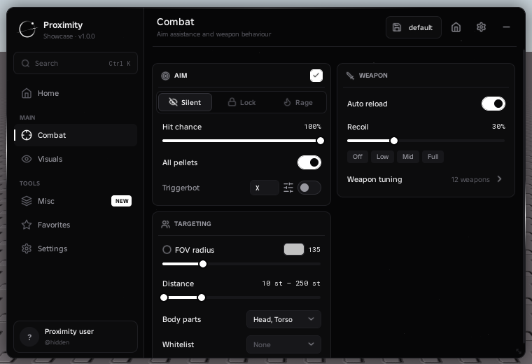
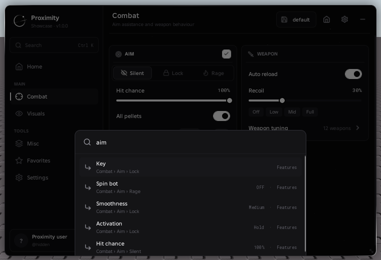
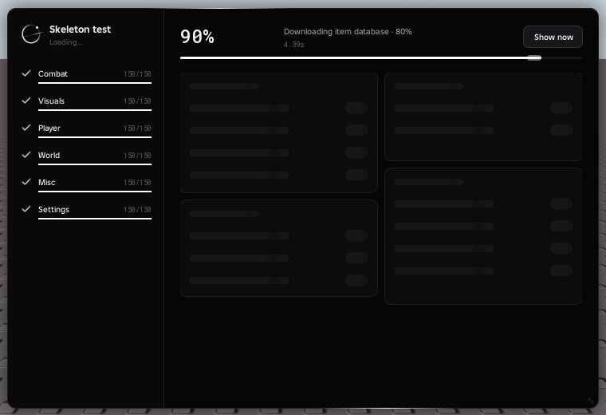
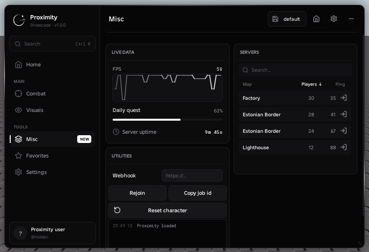

<div align="center">

<a href="README.md">English</a> · <b>Русский</b>



[](CHANGELOG.md)
[](LICENSE)
[](https://proximitydevproject.github.io/ProximityGUI/executors.html)
[](https://proximitydevproject.github.io/ProximityGUI/)

</div>

```lua
local Proximity = loadstring(game:HttpGet("https://proximitydevproject.github.io/ProximityGUI/Proximity.lua"))()
```

<sub>Фиксированная версия: <code>https://proximitydevproject.github.io/ProximityGUI/v/1.3.0.lua</code> · прямо из репозитория: <code>https://raw.githubusercontent.com/ProximityDevProject/ProximityGUI/main/dist/Proximity.luau</code></sub>

**Сайт с документацией, конструктором меню и живым статусом экзекуторов: https://proximitydevproject.github.io/ProximityGUI/** (на русском и английском)

---

## Быстрый старт

```lua
local Proximity = loadstring(game:HttpGet("https://proximitydevproject.github.io/ProximityGUI/Proximity.lua"))()

local Window = Proximity:Window({ Title = "Мой хаб", Animation = "Swing", Loading = { Style = "Planet" } })

local Combat = Window:Tab({ Name = "Бой", Icon = "crosshair" })
local Aim = Combat:Section({ Name = "Аим", Toggle = true, Flag = "aim" })

Aim:Toggle({ Name = "Сайлент аим", Flag = "aim.silent", Callback = function(on) end })
    :Keybind({ Default = "Ctrl+X", Mode = "Hold" })
Aim:Slider({ Name = "FOV", Min = 10, Max = 500, Default = 135, Danger = 400 })
Aim:Gallery({ Name = "Нож", Items = { { Name = "Обычный", Image = 10734898934 }, { Name = "Fade", Image = 10734919691, Rarity = "Rare" } } })

Proximity:Bind("aim.silent", function(on) end)   -- сразу, при каждом изменении и с false при выгрузке
Window:SettingsTab()                             -- темы, звуки, экран, сервер, вывод, конфиги
```

Никакого `Init()`: окно само замечает, что скрипт закончил объявлять элементы, и появляется.

## Возможности

<table>
<tr>
<td width="33%" valign="top"><br/><b>7 экранов загрузки</b><br/><sub>Planet, Orbit, Eclipse, Constellation, Terminal, Skeleton или без загрузки. Каждый показывает реальный прогресс и оставшееся время.</sub></td>
<td width="33%" valign="top"><br/><b>12 анимаций меню на пружинах</b><br/><sub>Planet, Rise, Zoom, Drop, Slide, Swing, Wipe, Unfold, Scan, Glitch, Fade. Нажми клавишу посередине - и анимация плавно развернётся.</sub></td>
<td width="33%" valign="top"><br/><b>Клавиша на что угодно</b><br/><sub>Правый клик по любому элементу: назначить клавишу, ввести точное значение, открыть его настройки. Работает даже там, где скрипт не дал бинда.</sub></td>
</tr>
<tr>
<td valign="top"><br/><b>Ctrl + K прощает опечатки</b><br/><sub>Ищет функции, вкладки и действия, понимает неправильную раскладку («ghbdtn» найдёт «привет») и мелкие ошибки.</sub></td>
<td valign="top"><br/><b>Конфиги, которые путешествуют</b><br/><sub>Защищённые файлы, резервные копии, отмена удаления, короткие коды, экспорт в JSON и Lua, сравнение, профиль на каждую игру, автосохранение.</sub></td>
<td valign="top"><br/><b>Выгрузка возвращает всё</b><br/><sub>Подключения, циклы, изменённые свойства, хуки, созданные объекты и бинды идут через библиотеку и откатываются.</sub></td>
</tr>
<tr>
<td valign="top"><br/><b>10 тем и 3D-логотип</b><br/><sub>Eclipse, OLED, Graphite, Moon, Ash, Steel, Paper, Midnight, Graphite Blue, Mono Glass. Высокая контрастность, форма углов, акцент из персонажа.</sub></td>
<td valign="top"><br/><b>Карточки-галерея</b><br/><sub>Карточки с картинками для скинов или телепортов: текущий выбор крупно сверху, все варианты ниже, полоски редкости, поиск.</sub></td>
<td valign="top"><br/><b>45+ элементов</b><br/><sub>Тоггл (9 стилей), слайдеры с опасной зоной, Segmented, Stepper, списки, таблицы, список игроков, превью ESP, редактор прицела, редактор кода.</sub></td>
</tr>
<tr>
<td valign="top"><br/><b>Виджеты</b><br/><sub>Вотермарка, список биндов, данные сессии, лента событий, лог чата, друзья на сервере, кто на тебя смотрит, инвентарь, музыкальный плеер.</sub></td>
<td valign="top"><br/><b>Звуки и медиа</b><br/><sub>Звуки кликов и уведомлений, 16 хитсаундов, 12 хитмаркеров, курсоры - скачиваются один раз и кэшируются.</sub></td>
<td valign="top"><br/><b>Для телефонов</b><br/><sub>Вкладки снизу, сенсорная плотность, безопасные зоны экрана, уведомления смахиваются, плавающая кнопка с планетой.</sub></td>
</tr>
</table>

## Сравнение с другими библиотеками

| | Proximity | Rayfield | Orion | Linoria |
|---|:---:|:---:|:---:|:---:|
| Экран загрузки с реальным прогрессом | да | только заставка | только заставка | - |
| Поиск по всему меню (Ctrl + K) | да | - | - | - |
| Отмена и повтор | да | - | - | - |
| Клавиша на любой элемент через правый клик | да | - | - | - |
| Выбор анимации открытия | 12 | - | - | - |
| Конфиги | да, с кодами и профилями на игру | да | да | да (дополнение) |
| Темы | 10 + редактор + импорт из этих трёх | да | частично | да (дополнение) |
| Выгрузка откатывает изменения скрипта | да | - | - | - |
| Вкладки снизу на телефоне | да | - | - | - |

<sub>По публичным версиям этих библиотек. Если что-то устарело, открой issue - поправим.</sub>

## Скриншоты

<table>
<tr>
<td width="50%"><br/><sub><b>Секции</b> - заголовки-переключатели, вкладки внутри секции, привязанные бинды и цвета</sub></td>
<td width="50%"><br/><sub><b>Ctrl + K</b> - переход к любой функции, вкладке или действию</sub></td>
</tr>
<tr>
<td><br/><sub><b>Скелет загрузки</b> - каждая вкладка строится со своим прогрессом</sub></td>
<td><br/><sub><b>Данные</b> - живые графики, прогресс и таблицы с сортировкой</sub></td>
</tr>
</table>

## Для авторов скриптов

```lua
-- всё, что делает твой скрипт, можно откатить при выгрузке
Proximity:Connect(game:GetService("RunService").Heartbeat, function() end)
Proximity:SetProperty(workspace.CurrentCamera, "FieldOfView", 100)   -- вернётся при выгрузке
Proximity:HookFunction(someFunction, function(...) end)              -- хук снимется при выгрузке
Proximity:Loop(function() end, 0.5)

Proximity:Batch(function() ... end)          -- много :Set, одна перерисовка
Proximity:Use(myPlugin)                      -- плагины: элементы, темы, что угодно
Proximity:Localize({ en = { Aim = "Aim" } })  -- твой скрипт на других языках
Proximity:ImportTheme(rayfieldTheme, "Rayfield")
```

Полный справочник: **[docs/API.ru.md](docs/API.ru.md)** (на русском) · **[docs/API.md](docs/API.md)** (на английском) · пример со всем подряд: **[examples/Full.luau](examples/Full.luau)**

## Частые вопросы

**С какими экзекуторами работает?** Проверено на Potassium. Подойдёт любой с обычными файловыми функциями, буфером обмена и `getcustomasset`; без них Proximity всё равно работает и держит конфиги в памяти. Живой статус: [экзекуторы](https://proximitydevproject.github.io/ProximityGUI/executors.html).

**Работает на телефоне?** Да: вкладки снизу, строки крупнее и плавающая кнопка с планетой, чтобы открыть меню.

**Как игроки получают обновления?** Loadstring всегда указывает на последнюю сборку. Чтобы остаться на одной версии, используй ссылку `/v/<версия>.lua`.

**Как выгрузить?** `Proximity:Unload()` или кнопка в настройках, которую нужно удерживать. Всё, что скрипт зарегистрировал через библиотеку, откатится.

**Словарь.** *Флаг* - ключ, под которым значение сохраняется в конфиге. *Секция* - карточка с элементами внутри вкладки. *Страница* - один вид вкладки (у вкладок бывают подстраницы). *Бинд* - клавиша, которая срабатывает на элемент.

## Сборка из исходников

```bash
sh tests/build.sh
```

Исходники в `src/` собираются через [darklua](https://github.com/seaofvoices/darklua) и проверяются [Lune](https://lune-org.github.io/docs) и [selene](https://github.com/Kampfkarren/selene). Подробнее в [CONTRIBUTING.md](CONTRIBUTING.md).

## Благодарности

Proximity - оригинальный код. Идеи изучались в CompKiller, Neverlose Reloaded и MugiHub Gen 2 (все MIT). Иконки: набор Proximity (MIT) и [Lucide](https://lucide.dev) (ISC). Медиа описаны в [THIRD_PARTY.md](THIRD_PARTY.md).

<div align="center"><sub>MIT © Proximity</sub></div>
